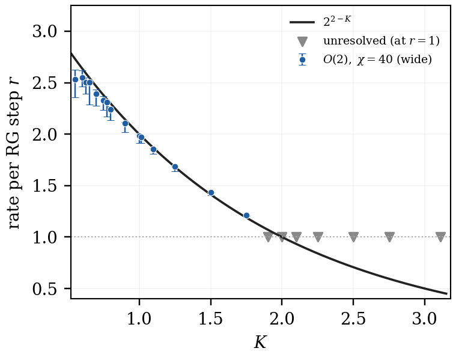
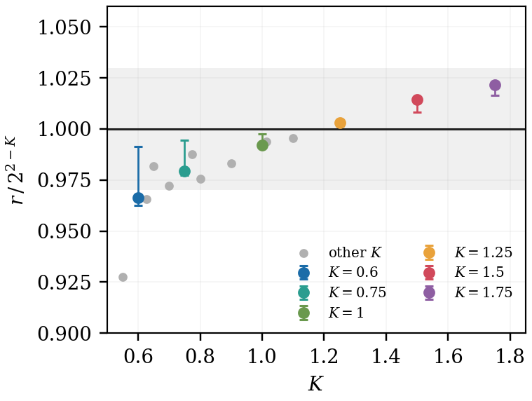

# 3_2 荷電準位から求める成長率

本文 **図3** · LaTeXラベル `fig:flows`

$O(2)$を保つLoopTNRの荷電準位の変化から、一段ごとの成長倍率 $r$ を推定します。横軸は入力の $K$、縦軸は $r$。$\chi=40$、tube $[\sqrt2,2\sqrt2,0]$ の22条件を使い、理論曲線 $2^{2-K}$ と比較します。



同じ測定の丸める前の準位から、umklappの項を理論の閾値で決めてfitし直した図を、[全精度の準位からの再fit](#全精度の準位からの再fit) に別の出力として置いています。§3.1を書き換えるときはこちらを使う予定です。

## 入力データ

テンソルは [大学アカウントのSix_vertex](<team Drive>) に保存されています。[measurement_plan.csv](measurement_plan.csv) の `record_id` で対象を選び、`drive_url` から取得して、ローカルの `Six_vertex/<catalog_path>` に置きます。`catalog_sha256` が取得後の照合値です。本文でいう $(a,b,c_{\mathrm v})$ とテンソル保存時の重みは、それぞれ `physical_*` と `catalog_*` に記録しています。

入力は [data/cft/](data/cft/) の次の5ログです。

- `sixvertex_rate_cft_fushio_chi40_dense_run1.log`
- `sixvertex_rate_cft_fushio_chi40_dense_run2.log`
- `sixvertex_rate_cft_fushio_chi40_dense_run3.log`
- `sixvertex_rate_cft_fushio_chi40_extra_run.log`
- `sixvertex_rate_cft_fushio_run.log`

合計1146行・22条件から、`c...`（頂点重み）、`step`、`c =`（中心電荷）、`K_m`、括弧内の $(K_m-K)/K$ を読みます。高精度の元測定ファイルは未確認です。テンソルとの対応は条件から得た候補で、元測定時のcheckpointハッシュによる一致ではありません。

## 実行手順

以下はリポジトリ直下からの実行例です。Python依存関係は初回に準備します。

```sh
TENSOR_ROOT="$(pwd)/local_tnr_data/Six_vertex"
cd research_note/paper/docs/03_o2/3_2_growth_rate
python3 -m pip install -r requirements.txt
python3 scripts/reproduce.py
```

生成図は [figures/sixvertex_growth_rate_wide.pdf](figures/sixvertex_growth_rate_wide.pdf) と [PNG](figures/sixvertex_growth_rate_wide.png) です。 `data/processed/` に推定量・fit結果・採否・検証結果を保存します。図フォルダを単独コピーした場合も、同梱CFTからの再解析はこの入口で実行できます。

`reproduce.py` → `analyze.py::main`（ログ読込・fit）→ `plot.py::plot`（作図）。fitの数値処理は `fit_method.py::fit` です。 個々の解析関数を直接実行せず、`reproduce.py` を使います。

### 保存テンソルから再測定する場合

この図フォルダ内で続けて実行します。単独コピーから使う場合は、`TENSOR_ROOT` をダウンロードした `Six_vertex` の絶対パスに設定してください。Julia 1.13.2と、同梱の [環境](environment/README.md) を使います。環境の初回準備には未取得パッケージのダウンロードが必要な場合があります。

```sh
julia --project=environment -e 'using Pkg; Pkg.instantiate()'
RUN_DIR="$(mktemp -d)"
python3 scripts/measure_cft.py --tensor-root "$TENSOR_ROOT" --output-dir "$RUN_DIR/cft" --preflight
python3 scripts/measure_cft.py --tensor-root "$TENSOR_ROOT" --output-dir "$RUN_DIR/smoke" --record-id m0001
```

`--preflight` は全対象の入力・ハッシュとJulia環境を確認します。`m0001` は [測定対象一覧](measurement_plan.csv) の1行だけを測る動作確認です。 単一点の結果だけでは全図を再解析できません。全入力が揃った場合に、次で全対象を測定し、新しいCFTから解析・作図します。

```sh
python3 scripts/measure_cft.py --tensor-root "$TENSOR_ROOT" --output-dir "$RUN_DIR/cft" --all
python3 scripts/reproduce.py --cft-dir "$RUN_DIR/cft" --output-dir "$RUN_DIR/analysis"
```

`measure_cft.py` が `measure_kernel.jl` を呼び、指定した保存テンソルのCFTだけを計算します。RGは進めません。新規結果は指定先に保存し、既存ファイルがあれば停止します。 高精度の測定値は `raw/mXXXX.toml` に残し、掲載図と同じ丸め処理を通す入力ログも出力します。 測定条件・完了範囲は `measurement_report.json`、実行出力は `measurement.log` に残ります。再測定値を使う場合、掲載値との一致は `data/processed/validation.json` で別に確認します。

## 解析方法

入力重みを $c_{\mathrm v}$ として、固定する入力値は $K=\pi/[4\arcsin(c_{\mathrm v}/2)]$ です。電荷1の最低準位 $x_{0,1}$ から

$$
K_m(n)=\frac{1}{4x_{0,1}(n)},\qquad
X(n)=1-\frac{K}{K_m(n)}=1-4Kx_{0,1}(n)
$$

を作ります。ログには丸めた $K_m$ と $(K_m-K)/K$ があるため、両方の丸め区間の共通部分を求め、その中点を使用します。区間端も保存します。中点を使っても元測定の精度は増えません。

fit窓を $n_s\le n\le n_e$、$t=[n-(n_s+n_e)/2]/10$ として、

$$
f(n)=a+bt+A r^{n-n_e}
 +B\,[2^{2-4K}]^{n-n_s}
 +C(-1/2)^{n-n_s}+D(1/2)^{n-n_s}
$$

を使います。$a+bt$ が背景、$A$ の項が成長成分、$B$ の項がumklapp、$C,D$ が減衰する補正です。$r>0$ と各振幅をfitし、$2^{2-4K}$ と $\pm1/2$ は固定します。$r$ を固定するたびに振幅を線形最小二乗で求め、$\log r$ を一次元Nelder–Meadで探索します。最小化する量は **符号付き $X$ の $\sum_n[X(n)-f(n)]^2$** です。絶対値化や対数化はfit前には行いません。

$K=0.75$ では $2^{2-4K}=1/2$ となるため、$B,D$ の同じ列を一つにまとめます。

まずRG6から $|X|\le0.10$ の連続窓で上式をfitします。その結果を用い、RG12でのumklapp成分が残差RMSを超える場合だけ、主fitに $B$ 項を残します。

主fitはRG12から初めて $|X|>0.10$ となる直前までです。背景 $a+bt$ と成長項は残し、$C,D$ は外します。ここで推定した $r$ を点として描きます。図2の背景fitで得た倍率とは窓・補正項が異なります。

エラーバーは、RSS profile、開始段10/12/14、上限0.05/0.10、推定量 $X$ と $K_m/K-1$、$C,D$ の復帰、丸め区間端と区間内16通りの変更から得た範囲の包絡です。区間内の値は乱数seed 20261101で固定します。RSS profileの閾値は $\mathrm{RSS}_{\min}[1+1/(N-p)]$ で、$N$ は採用点数、$p$ は自由パラメータ数です。これは条件を変えた感度の範囲で、確率モデルに基づく信頼区間ではありません。

個別の主fit窓・倍率は `data/processed/summary.json` の `main`、変更条件と各倍率は `sensitivity_fits.csv` に保存します。$K\ge1.9$ の7条件は自由倍率を識別した点として扱わず、図の $r=1$ の灰色三角は未識別を示す目印です。

## 全精度の準位からの再fit

上の図と同じ15条件の倍率を、丸める前の準位から求め直したものです。縦軸は予言との比 $r/2^{2-K}$ で、色の点が $K=0.6,0.75,1,1.25,1.5,1.75$、灰色の点がその他の $K$ です。灰色の帯は $\pm3\%$ の目安です。



**入力**:[data/cft/o2_levels.csv](data/cft/o2_levels.csv) と [o2_runs.csv](data/cft/o2_runs.csv)。上の `data/cft/*.log` と同じ測定(`Otsuki/sixvertex/scripts/sixvertex_rate_measure.jl`)が保存したCFT記録(`Otsuki/sixvertex/data/sixvertex_rate_cft_*.jls`、gitには入っていません)から、`Otsuki/sixvertex/scripts/sixvertex_o2_export_levels.jl` が電荷1の最低準位 $\Delta_{0,1}$ と `(0,1)` の下から3本を全精度で書き出したものです。列の意味は [3_4のREADME](../3_4_amplitude_ratio/README.md#入力データ) にあります。この図は $\chi=40$、$K<2$ の15系列を使います。各系列の `source` は台帳のテンソルグループで、[tensor_sources.csv](tensor_sources.csv) の行と同じテンソルを指します。

**実行**:`scripts/reproduce.py` が、上の解析の前に `scripts/o2_figure.py` を呼びます。単独でも `python3 scripts/o2_figure.py` で動きます。出力は [data/processed_o2/rates.csv](data/processed_o2/rates.csv)(条件ごとの窓、$B$ 項の有無、$r$、1σの範囲、窓による範囲、比)、[validation.json](data/processed_o2/validation.json)、[figures/sixvertex_o2_rate.pdf](figures/sixvertex_o2_rate.pdf) です。比較基準は [data/reference_o2/rates.csv](data/reference_o2/rates.csv)(相対許容差 $10^{-8}$)です。`--cft-dir` で差し替えたCFTに `o2_levels.csv` がないときは、この解析を飛ばします。

**方法**:$x(n)=1-4K\Delta_{0,1}(n)$ を、RG12から初めて $|x|>0.10$ となる直前まで

$$
f(n)=c+d\,t+A\,r^{\,n-n_e}\;\bigl[+B\,s^{\,n-n_s}\bigr],\qquad s=2^{2-4K},\quad t=\frac{n-(n_s+n_e)/2}{10}
$$

で、符号付きの $x$ に重みなしでfitします。$r$ 以外の倍率は固定です。$B$ 項は $2^{2-4K}>1/2$、すなわち $K<3/4$ のときだけ入れます。次元4の補正($\pm1/2$ で減る)はRG12までに読出しの床(この $\chi$ で $|x|\sim10^{-4}$)を下回りますが、umklappの二次はこの範囲でだけそれより遅く減って残るからです。15条件では $K=0.55,0.6,0.63,0.65,0.7$ が該当します。これは、RG6からのfitで求めたRG12でのumklapp成分が $10^{-4}$ を超える条件と一致します。$r$ を決めるたびに係数を線形最小二乗で求め、$\log r$ を $[\log1.02,\log4]$ の400点の格子で粗く探してから、有界Brent法で絞ります。エラーバーは、RSS profile($\mathrm{RSS}\le\mathrm{RSS}_{\min}[1+1/(N-p)]$)の範囲と、開始段10/12/14・上限0.05/0.10の6通りの $r$ の範囲を合わせたものです。

**上の図との違い**:

| | 上の図 | この図 |
|---|---|---|
| 入力 | 丸めたログ($K_m$ は小数5桁)。丸め区間の中点 | 丸める前の値 |
| $B$ 項 | RG12でのumklapp成分が残差RMSを超える条件 | $K<3/4$(15条件では同じ選択になる) |
| エラーバー | profile、窓、観測量 $K_m/K-1$、$C,D$ の復帰、丸め区間の包絡 | profileと窓 |
| 縦軸 | $r$。$K\ge1.9$ を未識別の三角で表示 | $r/2^{2-K}$。$K<2$ だけ |

主fitの $r$ は、15条件すべてで上の図の値と0.05%以内で一致します(差が最大の $K=0.75$ で2.3296と2.3291)。違いはエラーバーで、上の図は観測量の取り替えと $C,D$ の復帰を含むため、下側に大きく広がります(例:$K=1$ で上の図は1.915–1.995、この図は1.982–1.995)。

**読み取れること**:$K=0.6$–$1.75$ の6条件で、$r/2^{2-K}$ は0.966–1.022です。$K\le1$ では1–3%低く、$K\ge1.5$ では1–2%高い系統的な傾向があり、$K\ge1.25$ の高さは区間の上限を上げるほど増えます。この傾向の原因は定量的には確かめていません。この解析の元は Otsuki の Julia のスクリプト(`Otsuki/sixvertex/scripts/sixvertex_rate_driftfit.jl`、`sixvertex_o2_coupling_figs.jl`)で、6条件の $r$・比・範囲・窓・$B$ 項の有無が、その出力 `Otsuki/sixvertex/logs/sixvertex_o2_coupling_figs_report.log` の1節と表示の桁まで一致します。numpy 1.26.4 と 2.2.6 の両方で比較基準との照合が通ることを確かめました。来歴とハッシュは [provenance.json](provenance.json) の `o2_refit` にあります。

## 読み取れることと限界

15条件で成長倍率を推定し、7条件では未識別とします。理論倍率との対応は摂動解釈を支える診断ですが、単一準位の倍率だけで演算子を一意に同定するものではありません。

入力の出典・ハッシュは [provenance.json](provenance.json)、テンソルとの対応は [tensor_sources.csv](tensor_sources.csv)、測定コード・環境の来歴は [measurement_environment.json](measurement_environment.json) を参照してください。Driveの全ファイルを再取得して内容照合した記録ではありません。

[今回の検証記録](../../../../../Fushio/docs/organization/selfcontained_docs_validation_20261101.json) · [関連TODO](../../../TODO.md#todo-3-growth) · [章の案内](../README.md) · [全図の案内・AI向け作成手順](../../README.md)
