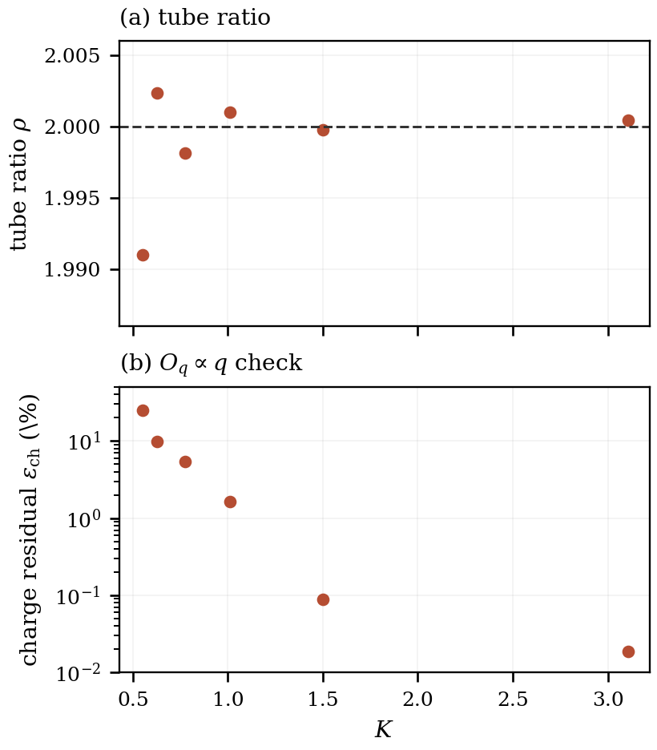

# B_1 tube・高電荷の補助診断

本文 **図7** · LaTeXラベル `fig:u1-checks`

同じテンソルのtubeを変えたときの分裂振幅と、高電荷までの電荷比例性を確認します。横軸は入力の $K$、縦軸は上段がwide/smallの振幅比 $\rho$、下段が電荷比例性の残差 $\epsilon_{\rm ch}$（%）です。$U(1)$、$\chi=40$ の旧6条件 $c_{\mathrm v}=0.5,1,1.4,1.7,1.9,1.98$ を使います。smallは $[\sqrt2,\sqrt2,0]$、wideは $[\sqrt2,2\sqrt2,0]$ です。本文図5・6の代表6条件とは異なります。



## 入力データ

テンソルは [大学アカウントのSix_vertex](<team Drive>) に保存されています。[measurement_plan.csv](measurement_plan.csv) の `record_id` で対象を選び、`drive_url` から取得して、ローカルの `Six_vertex/<catalog_path>` に置きます。`catalog_sha256` が取得後の照合値です。本文でいう $(a,b,c_{\mathrm v})$ とテンソル保存時の重みは、それぞれ `physical_*` と `catalog_*` に記録しています。

入力は [data/cft/](data/cft/) 内のsmall 336記録とwide 137記録（TOML）です。例えばsmallの `small/U1Irrep/c_0.5/measurements/step_015.toml` と、wideの `wide/perturbation_chi40_cu1_u1_20261021/U1Irrep/c_0.5/step_016_wide.toml` があります。全ファイルは `measurement_plan.csv` の `cft_record` 列で指定します。`observables.x1,xm1,…,x3,xm3`、`central_charge,status,rg_step,vertex_c` を読みます。smallの元記録はアーカイブのハッシュと照合して復元しました。

smallにはテンソルが作られなかった `rg_unavailable` の46記録が含まれます。これらは再測定できません。残るsmall 290記録は条件によるテンソル候補、wide 137記録はcheckpointハッシュ一致です。[provenance/extraction.json](provenance/extraction.json) に抽出元を記録しています。

## 実行手順

以下はリポジトリ直下からの実行例です。Python依存関係は初回に準備します。

```sh
TENSOR_ROOT="$(pwd)/local_tnr_data/Six_vertex"
cd research_note/paper/docs/appendix_b/B_1_u1_tube_charge_checks
python3 -m pip install -r requirements.txt
python3 scripts/reproduce.py
```

生成図は [figures/u1_current_appendix_checks.pdf](figures/u1_current_appendix_checks.pdf) と [PNG](figures/u1_current_appendix_checks.png) です。 `data/processed/` に推定量・fit結果・採否・検証結果を保存します。図フォルダを単独コピーした場合も、同梱CFTからの再解析はこの入口で実行できます。

`reproduce.py` → `analyze.py::main`（準位差・tube比較・振動fit）→ `plot.py::plot_legacy_appendix`（作図）。 個々の解析関数を直接実行せず、`reproduce.py` を使います。

### 保存テンソルから再測定する場合

この図フォルダ内で続けて実行します。単独コピーから使う場合は、`TENSOR_ROOT` をダウンロードした `Six_vertex` の絶対パスに設定してください。Julia 1.13.2と、同梱の [環境](environment/README.md) を使います。環境の初回準備には未取得パッケージのダウンロードが必要な場合があります。

```sh
julia --project=environment -e 'using Pkg; Pkg.instantiate()'
RUN_DIR="$(mktemp -d)"
python3 scripts/measure_cft.py --tensor-root "$TENSOR_ROOT" --output-dir "$RUN_DIR/cft" --preflight
python3 scripts/measure_cft.py --tensor-root "$TENSOR_ROOT" --output-dir "$RUN_DIR/smoke" --record-id m0001
```

`--preflight` は全対象の入力・ハッシュとJulia環境を確認します。`m0001` は [測定対象一覧](measurement_plan.csv) の1行だけを測る動作確認です。 この図の全件確認では、上記46件の `no_checkpoint_mapping` が報告されます。単一点を確認する場合は `--preflight --record-id m0001` とします。全473記録の再測定はできないため、掲載図の完全再現には同梱CFTを使います。

`measure_cft.py` が `measure_kernel.jl` を呼び、指定した保存テンソルのCFTだけを計算します。RGは進めません。新規結果は指定先に保存し、既存ファイルがあれば停止します。 測定条件・完了範囲は `measurement_report.json`、実行出力は `measurement.log` に残ります。再測定値を使う場合、掲載値との一致は `data/processed/validation.json` で別に確認します。

## 解析方法

入力の $K=\pi/[4\arcsin(c_{\mathrm v}/2)]$ を使い、$E_q=(x_{+q}+x_{-q})/2$、$O_q=(x_{+q}-x_{-q})/2$、$\delta E_1=E_1-1/(4K)$ を作ります。

wideのRG15以降で、`status=ok`、$|O_1|/[1/(4K)]\le0.25$、$|\delta E_1|/[1/(4K)]\le0.10$、$|c-1|\le0.20$ が続く区間を選びます。最初の不合格で止め、RG18以降の最後の最大12点を使います。

$$O_1(n)=e^{\lambda(n-n_e)}\{u\cos(3\pi n/4)+v\sin(3\pi n/4)\}.$$

位相 $3\pi/4$ は固定します。符号付き $O_1$ の二乗残差を、$0.1\le\lambda\le0.7$ の範囲で `minimize_scalar` により最小化し、その都度 $u,v$ を線形最小二乗で求めます。補助fitの成長指数は $y=\lambda/\log\sqrt2$ です。これはCSVに保存する診断値で、この図の軸には使いません。

| 頂点重み c_v | 主fitのRG窓 |
|---|---|
| 0.5 | 19–30 |
| 1.0 | 23–34 |
| 1.4 | 19–30 |
| 1.7 | 18–27 |
| 1.9 | 18–29 |
| 1.98 | 18–26 |

窓の8/10/12点・終端0/1/2段移動から指数の範囲を求めます。同じ主fit窓のベクトルを使い、tube振幅比を $\rho=(O_1^{\rm small}\cdot O_1^{\rm wide})/(O_1^{\rm small}\cdot O_1^{\rm small})$ とします。電荷比例性には $B=\sum qO_q/14$ を使い、$\epsilon_{\rm ch}=\sqrt{\sum_{n,q}(O_q-qB)^2/\sum_{n,q}O_q^2}$ を求め、図には百分率を表示します。

`odd_current_fits.csv` に指数・tube比・電荷残差、`odd_fit_sensitivity.csv` に変更窓、`selection_audit.csv` に主解析／感度解析／未使用の区別を保存します。

## 読み取れることと限界

wide/smallの振幅比は約2、成長指数は約1です。tubeの変更で読出しの振幅が変わることを示し、有限χのRG情報が回復したことを意味しません。位相を固定した旧条件の診断なので、図6の自由位相fitとは分けて扱います。

入力の出典・ハッシュは [provenance.json](provenance.json)、テンソルとの対応は [tensor_sources.csv](tensor_sources.csv)、測定コード・環境の来歴は [measurement_environment.json](measurement_environment.json) を参照してください。Driveの全ファイルを再取得して内容照合した記録ではありません。

[今回の検証記録](../../../../../Fushio/docs/organization/selfcontained_docs_validation_20261101.json) · [関連TODO](../../../TODO.md#todo-b) · [章の案内](../README.md) · [全図の案内・AI向け作成手順](../../README.md)
