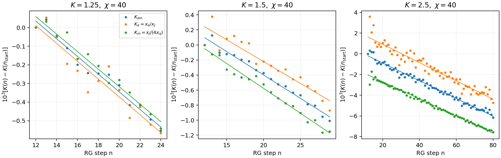
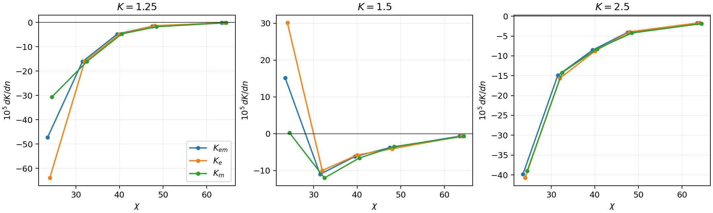

# $K_n$ の drift の推定法依存性：R-02 の追加検証

2026-11-12。Fushio の依頼に基づく Codex による解析。**[AI未確認：追加解析・解釈は本人確認待ち]**。
元の R-02 の本人確認と、この追加結果の確認は別に扱う。

## 結果と判断

**$K=2.5$ では負の drift を支持する。標準窓で別の推定法と元の推定法との傾き差は、各 $\chi$ で最大2.3–6.4%であり、窓を変えても全て負だった。**
したがって、少なくともこの条件で「別の準位を使うと drift が消える」という結果ではない。
$K=1.25,1.5$ の $\chi=40$ でも、標準窓の傾きと元の推定法との差はそれぞれ最大0.9%、6.6%だった。
一方、$K=1.25,\chi=64$ と $K=1.5,\chi=24$ は窓によって符号が変わり、一律に同じ精度とは言えない。
wide tube では同じ段数区間でも傾きが変わる。これは readout 条件依存の存在を示すが、wide 自体にも追加切断があり、どちらが正しいかを決めるものではない。

R-02 は「検証が全くない」という形で維持する必要はない。**推定法・窓に対する安定性は支持された範囲を追記し、共通の系統誤差は未評価という点を残す**のが適切。

## データ・方法

- RG・固有値計算は追加せず、[標準スペクトル](../../runs/main/data/)の保存CSVを読む。
- 対象は $K=1.25,1.5,2.5$、$\chi=24,32,40,48,64$ の15条件。
- [既存 drift.py](../../runs/main/analysis/drift.py) と同じ $x_e=(x_E+x_O)/2$、最低電荷1準位 $x_q$ を使用。電気準位はセクター内で入力 $K$ に最も近いものを選ぶ。対象窓では電気準位の順位は各run内で一定だった。
- current は $C$-odd neutral の $x=1$ に近い2準位（順位1,2）の平均を主解析に使用。元コードの「1に最も近い片方」も別に計算し、選択の影響を記録。
- 標準窓は $n\ge12$、既存成長フィットの $|A r^{n-n_e}|<10^{-4}$。$K=2.5$ は $n=12$–80。全推定を同一の点集合で比較する。
- 標準データの選択準位は保存された convergence 数と順位を照合。固有対残差の最大は $1.24\times10^{-12}$。これは固有値計算の精度であり、切断・readout の系統誤差の上限ではない。

比較する量は

$$
K_{em}=\frac12\sqrt{\frac{x_e}{x_q}},\qquad
K_e=\frac{x_e}{x_J},\qquad
K_m=\frac{x_J}{4x_q}.
$$

共通の倍率誤差は全てで消える。各量を $a+bn$ に最小二乗フィットし、傾き $b=dK/dn$ を比較する。
定数オフセットは drift と区別する。$K_{em}^2=K_eK_m$ が厳密に成立するので、独立な3測定ではなく current を追加した整合性検査である。

## 標準窓での全結果

| $K$ | $\chi$ | RG 窓 | $10^5 b_{em}$ | $10^5 b_e$ | $10^5 b_m$ | 最大の傾き差 / $\lvert b_{em}\rvert$ |
|---|---|---|---|---|---|---|
| 1.25 | 24 | 12–17 | -47.2491 | -63.9296 | -30.6028 | 35.30% |
| 1.25 | 32 | 12–24 | -16.0809 | -16.0867 | -16.0750 | 0.04% |
| 1.25 | 40 | 12–24 | -4.7430 | -4.7853 | -4.7007 | 0.89% |
| 1.25 | 48 | 12–25 | -1.5261 | -1.3194 | -1.7328 | 13.55% |
| 1.25 | 64 | 12–30 | -0.1035 | -0.0896 | -0.1174 | 13.46% |
| 1.5 | 24 | 12–20 | +15.1397 | +30.1379 | +0.2029 | 99.07% |
| 1.5 | 32 | 12–26 | -11.0096 | -10.0030 | -12.0159 | 9.14% |
| 1.5 | 40 | 12–29 | -6.1898 | -5.7796 | -6.6000 | 6.63% |
| 1.5 | 48 | 12–30 | -3.7991 | -4.0990 | -3.4994 | 7.89% |
| 1.5 | 64 | 12–37 | -0.6794 | -0.6710 | -0.6879 | 1.25% |
| 2.5 | 24 | 12–80 | -39.8673 | -40.7741 | -38.9625 | 2.27% |
| 2.5 | 32 | 12–80 | -14.9275 | -15.6250 | -14.2307 | 4.67% |
| 2.5 | 40 | 12–80 | -8.5475 | -8.8420 | -8.2536 | 3.45% |
| 2.5 | 48 | 12–80 | -4.0915 | -3.9359 | -4.2473 | 3.81% |
| 2.5 | 64 | 12–80 | -1.7639 | -1.6509 | -1.8772 | 6.43% |



点は各推定の最初の値からの変化、同色の線は一次フィット。誤差棒は付けていない。



横方向の微小なずらしは点の重なりを避けるため。結ぶ線は視線誘導であり理論曲線ではない。

## 窓と current の選択への感度

- $K=2.5$：始点12,16,20、終点60,70,80の9窓。
- $K<2$：始点10,12,14、成長項のcut $5\times10^{-5},10^{-4},2\times10^{-4}$ の組合せ。6点未満は傾きの比較から除外した。10開始は過渡補正を含み得るため感度検査として扱う。
- これらは決定論的データの解析感度であり、統計的信頼区間ではない。一次フィットのRMS残差だけから系統誤差を推定しない。

| $\chi$（$K=2.5$） | 窓・推定法を変えた傾きの全範囲（$10^{-5}$/step） |
|---|---|
| 24 | -46.2094 ～ -36.7881 |
| 32 | -17.0722 ～ -14.0931 |
| 40 | -9.0880 ～ -7.9786 |
| 48 | -4.5623 ～ -3.7561 |
| 64 | -2.0418 ～ -1.5791 |

$K=2.5$ では current の片方から平均への変更による傾きの差も元の傾きの0.1–3.0%で、負の符号は安定。
ただし $K=1.25,\chi=64$ の元の推定の傾きは窓により $-2.52\times10^{-6}$ ～ $+0.60\times10^{-6}$、
$K=1.5,\chi=24$ は $-5.72\times10^{-5}$ ～ $+2.33\times10^{-4}$ となる。
短い窓・小さい drift では、この確認だけで物理的な符号や大きさを確定しない。

$K=2.5$ の5つの $\chi$ で $|b|\propto\chi^p$ をフィットすると、
$K_{em}$: $p=-3.177$, $K_e$: $p=-3.284$, $K_m$: $p=-3.074$
となる。約 $-3.2$ という経験的な指数は推定法を変えても大きくは変わらないが、理論的導出や漸近指数の確定ではない。

## 保存済み wide-tube 読み出しとの比較

[wide_readout.jl](../../runs/additional/wide_readout.jl) による
[W1データ](../../runs/additional/data/)から、標準窓と共通する同じ段数だけを使った。
円周は標準の $\sqrt5$ 倍、$\tau=0.1+0.2i$、追加の coarse-graining を同じ $\chi$ で切断する。
元のRG軌道の $\chi$ を増やした検査ではない。標準窓の選択条件をそのまま使っており、wide では relevant 補正の振幅自体も増えるため、差を純粋な測定誤差だけには帰属できない。
W1のCSVには固有対残差・convergence欄がなく、標準と同じ数値精度の検査はできない。
$K=2.5$ の対応するW1データは今回の保存集合にない。

| $K$ | $\chi$ | standard の $10^5 b_{em}$ | wide の $10^5 b_{em}$ | 傾き差 / standard の $\lvert b_{em}\rvert$ |
|---|---|---|---|---|
| 1.25 | 40 | -4.7430 | -6.2311 | -31.4% |
| 1.5 | 24 | +15.1397 | +26.7789 | +76.9% |
| 1.5 | 32 | -11.0096 | -13.7170 | -24.6% |
| 1.5 | 40 | -6.1898 | -6.7847 | -9.6% |
| 1.5 | 48 | -3.7991 | -2.0578 | +45.8% |
| 1.5 | 64 | -0.6794 | -0.8105 | -19.3% |

$\chi=40$ では $K=1.25$ で31%、$K=1.5$ で10%程度の変化があり、負の符号は共通。
$K=1.5,\chi=48$ では元の推定の傾きが46%変わり、wide側の3推定間にも大きな差がある。
全ての条件について high-precision な drift 測定が確立したとは言えない。

## この検査で分かること・残ること

1. $K=2.5$ の負の drift と、$\chi=40$ の $K=1.25,1.5$ の負の drift は、別の準位を使った推定でも残る。
2. $K_n$ の基準値がずれるだけでなく、傾きそのものに対する推定法・窓の感度を測った。これは R-02 に対する具体的な追加証拠になる。
3. 全準位に「別の $K(n)$」と同じ形で入る共通バイアスは、同じスペクトル内の検査では除去できない。無バイアスの証明ではない。
4. 小さいdriftの条件とwide比較の不一致を残し、原稿は支持された条件・精度を限定して述べるのがよい。新規RGや追加readoutによる全系統誤差評価までは実施していない。

## 再実行・検証

```sh
python3 Fushio/my_notes/kn_drift_validation_20261112/analyze.py
```

- [analyze.py](analyze.py)：解析・図・本ノートを生成。元データは読み取りのみ。
- [slopes.csv](slopes.csv)：15条件の傾き・RMS残差・準位順位・品質確認。
- [estimator_steps.csv](estimator_steps.csv)：各段の選択準位と推定量。
- [window_sensitivity.csv](window_sensitivity.csv)：窓変更の結果。
- [wide_tube_comparison.csv](wide_tube_comparison.csv)：同じ段数区間でのtube比較。
- [chi_exponents.json](chi_exponents.json)：指数の経験的fit。
- [manifest.json](manifest.json)：入力ファイルとスクリプトのSHA-256、実行環境。入力の前後ハッシュ一致を確認。

元の $K_{em}$ の窓・点数と傾きは、保存された `drift_summary.csv` の15条件すべてを再現した（傾き差 $<10^{-12}$）。
恒等式 $K_{em}^2=K_eK_m$ も各段で検査した。図の表示を目視確認した。
