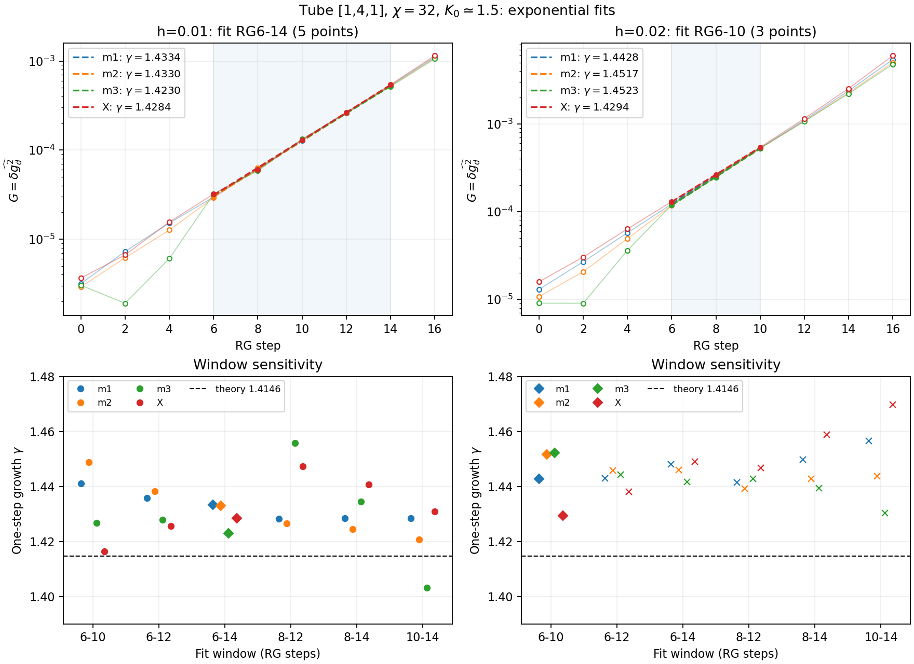

### RGを1段進めたときの増大率

まずは、背景を引いた値 $G_r(n)=\delta\widehat{g_{\mathrm d}^2}_r(n)$ を、次の指数関数でfitするのが自然です。$r$ は $m1,m2,m3,X$ の読み方、$\gamma_r$ はRGを1段進めたときの倍率です。

$$
G_r(n)=A_r\gamma_r^{\,n-n_0},\qquad
\log G_r(n)=\log A_r+(n-n_0)\log\gamma_r.
$$

正の値に対して $\log G_r$ を同じ重みで直線fitします。これで、値が大きい後半だけにfitが引っ張られるのを抑え、各点の相対的なずれを比べられます。$n_0$ はfit区間の中央に置き、$A_r$ と $\gamma_r$ を求めました。

二量体化の演算子の次元は $K_0$ なので、弱い摂動では $g_{\mathrm d}\propto L^{2-K_0}$ と育ちます。演算子の対応は [Takayoshi–Sato, Sec. II.2](https://arxiv.org/html/1005.1704#S2.SS2) を参照してください。今回の $L\propto2^{n/2}$ を代入すると、図の **二乗の量** に対する理論値は

$$
\gamma_{\mathrm{th}}=2^{2-K_0}=1.4146092\simeq\sqrt{2}
$$

です。保存点の間隔は2段なので、隣の点では約2倍になります。$g_{\mathrm d}$ 自体の1段あたりの倍率は $\sqrt{\gamma}$ です。

fitには、初期の読み方による差が大きいRG0・2・4を外し、上の弱い摂動の目安を満たす連続した範囲を使いました。$h=0.01$ はRG6〜14の5点、$h=0.02$ はRG6〜10の3点です。理論値への近さで区間を選ぶことはしていません。

上段の破線がfit、塗りつぶした点がfitに使った点です。下段では区間を動かして求めた倍率を比べます。ひし形は上段のfit、丸は目安を満たす別区間、×は弱い摂動の範囲を超える点を含む参考値です。

$h=0.01$ の増大率は4通りで **1.4230〜1.4334**、$h=0.02$ は **1.4294〜1.4523** でした。理論値との差は、それぞれ約0.6〜1.3%、約1.0〜2.7%です。

$h=0.02$ は3点で2つのパラメータを決めているため、増大率の暫定値として扱います。$h=0.01$ は区間を動かすと、とくに $m3$ と $X$ の値が変わります。この幅を、いま残っている読み方・区間への依存として見ます。4通りは同じ3つの電荷準位から作っているため、平均して独立な4測定として誤差を小さくする扱いは避けます。

定数を足した $G=A\gamma^{n-n_0}+C$ や、さらにdriftを足すfitは、点が増えてから比較するのがよさそうです。とくに3点では $A,\gamma,C$ を動かす余地が大きく、増大率が背景の仮定に強く依存します。背景差し引き後にも残る有限 $\chi$ や高次の補正は、今回の区間依存と理論値との差に含まれます。まずは2パラメータの指数fitと区間比較を採用します。

全区間のfitは[CSV](growth_fits.csv)、条件と理論値は[JSON](growth_fits.json)、隣接点の倍率 $[G(n+2)/G(n)]^{1/2}$ は[別CSV](growth_local_rates.csv)に保存しました。[解析コード](fit_growth.py)から再現できます。ここで示した幅は読み方の違いで、統計的な信頼区間は付けていません。
